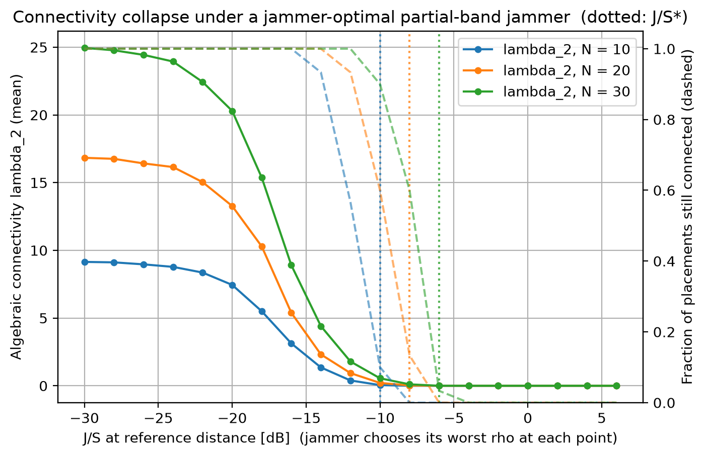
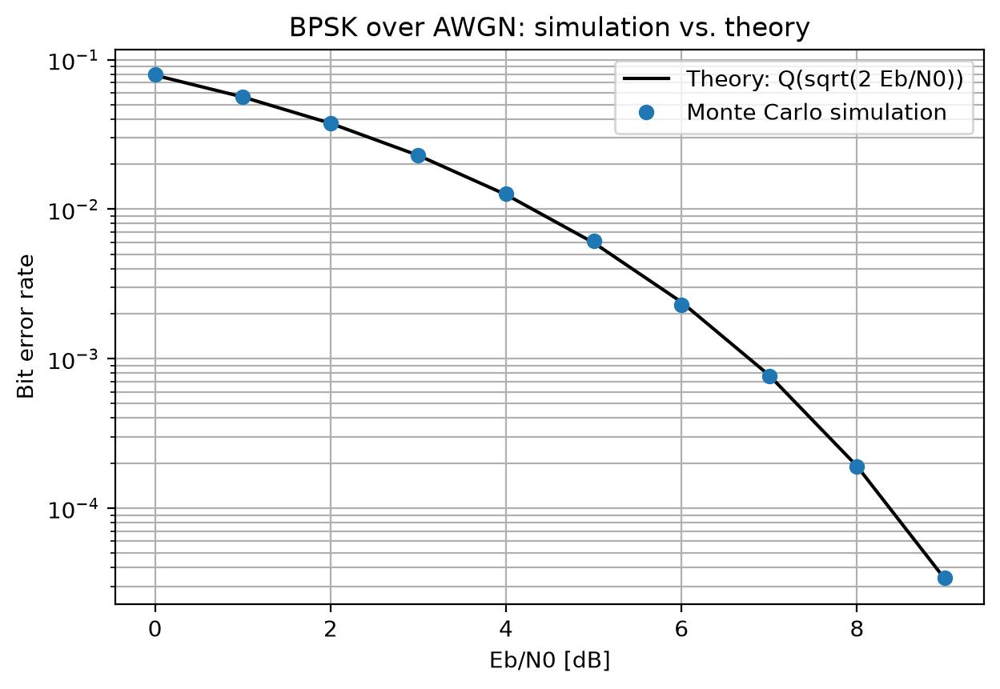
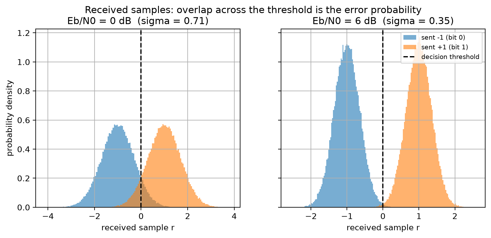
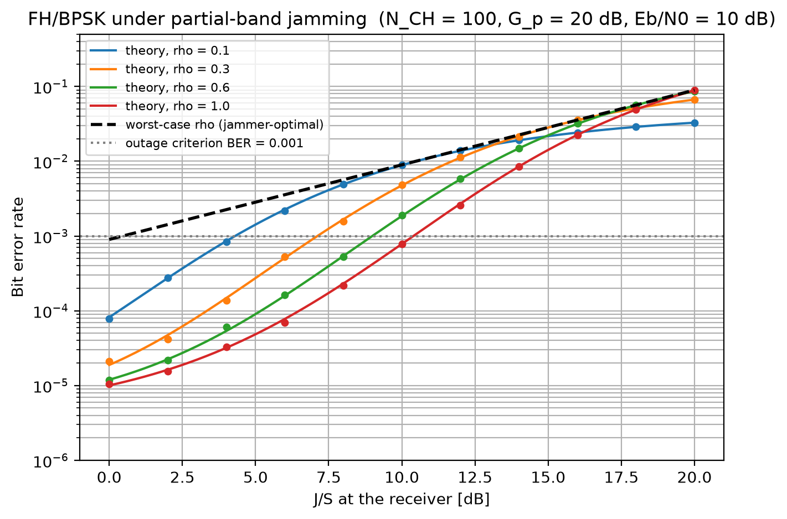
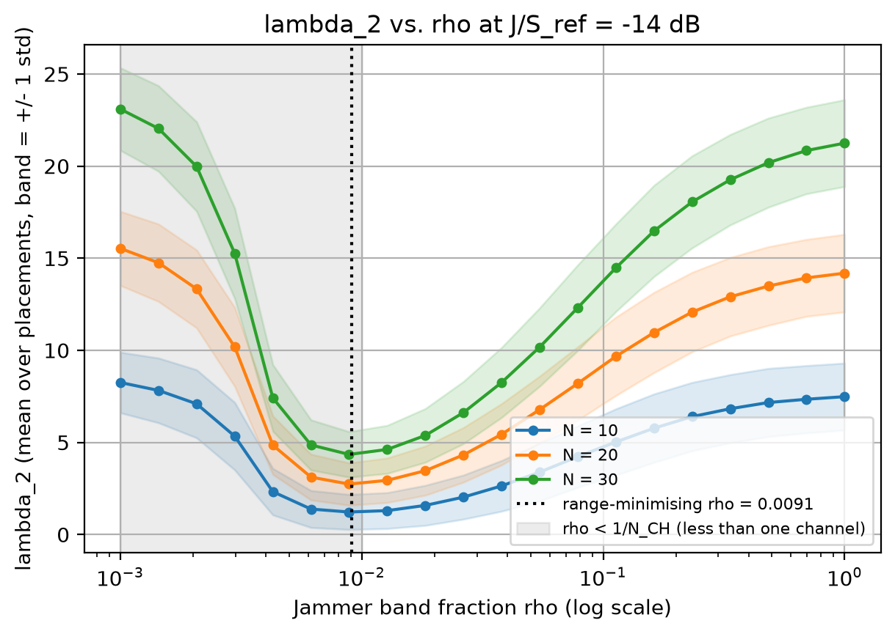
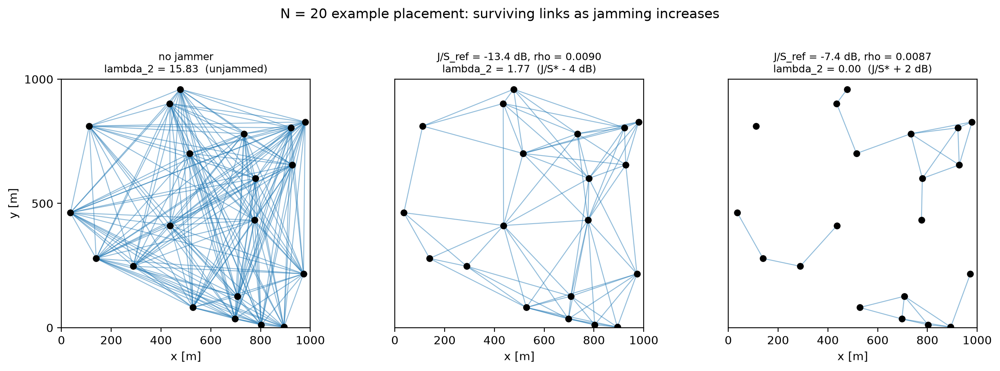
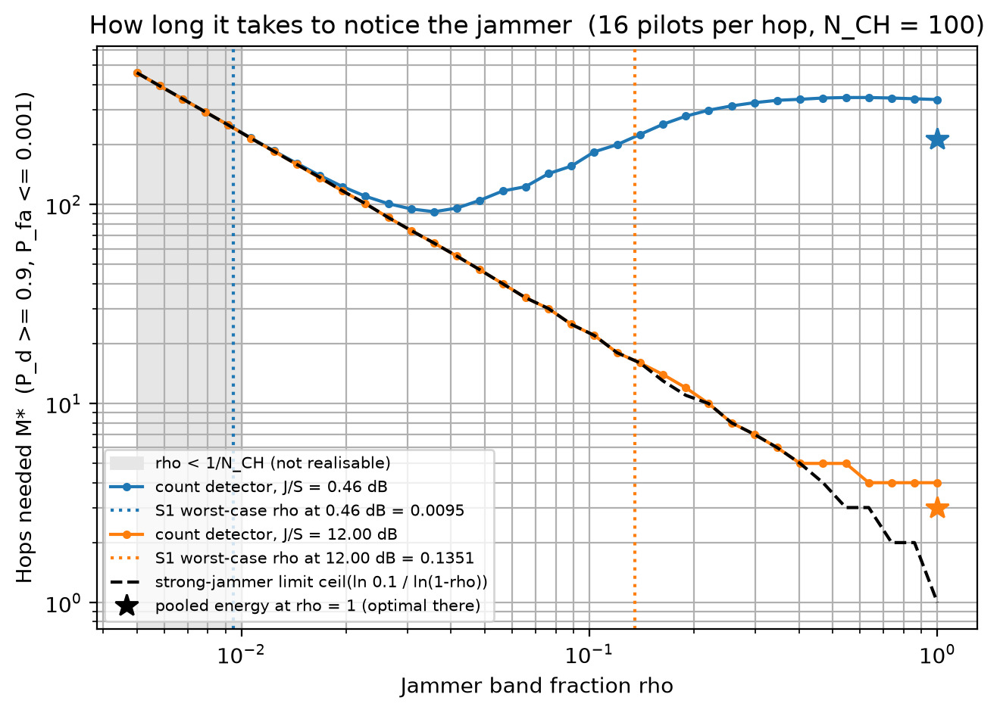
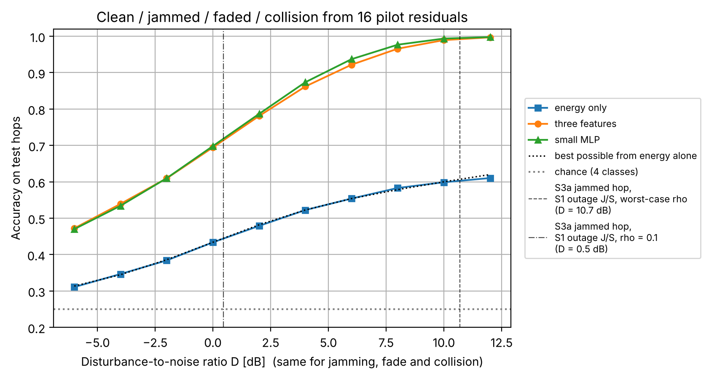

# Connectivity of a frequency-hopping network under partial-band jamming

As a signal officer I operated multi-node frequency-hopping VHF radio nets.
Hopping was our main protection against jamming, and when links began to fail
we judged link by link, largely from experience, whether the net as a whole
would hold. This project is my attempt to put numbers on that question: how
much jamming a hopping network can absorb before it splits apart.

Simulation study of how the connectivity of a multi-node frequency-hopping
network degrades under partial-band jamming, measured by the algebraic
connectivity [1] (second-smallest Laplacian eigenvalue, λ₂) of the link graph.

This is a self-directed learning project built in stages. Each stage is checked
against a closed-form result or a known limiting case. All physical parameters
are assumed values, listed with their reasons in [Parameters](#parameters);
nothing here models a specific radio.

## Main result



N nodes are placed at random in a square of side L and a distant partial-band
jammer uses the band fraction ρ that damages the network most. J/S\* is the
jammer-to-signal ratio at which half of 500 random placements are no longer
connected. It is negative because it is referred to a 100 m link; the longest
surviving link at J/S\* (0.42 L for N = 10) is at the single-link outage point
of S1.

| N | J/S\* (95 % interval) | link range at J/S\* | closed form (S2 note, Eq. 2) | 50 % knee of mean λ₂ |
|---|---|---|---|---|
| 10 | −11.8 dB (−12.0 .. −11.6) | 0.42 L | −11.7 dB | −17.4 dB |
| 20 | −9.4 dB (−9.6 .. −9.3) | 0.32 L | −9.4 dB | −17.2 dB |
| 30 | −7.9 dB (−8.1 .. −7.8) | 0.27 L | −7.9 dB | −17.2 dB |

- Ten more nodes buy 2.4 dB of jamming tolerance from N = 10 to 20 and 1.5 dB
  from 20 to 30: the gain per added node shrinks.
- λ₂ has lost half of its unjammed value about 6–9 dB *before* the network
  disconnects, and that knee is nearly the same for all three sizes.
- The thresholds follow from two known ingredients: the inverse-linear
  worst-case BER law of partial-band jamming (S1) and the link range needed to
  keep N random points connected. The closed form built from them agrees with
  the simulation to about 0.1 dB.

## Motivation

In a multi-node wireless network, individual links fail as jamming intensifies.
Counting failed links does not tell you whether the network is still one piece.
The Laplacian eigenvalue λ₂ does: it is zero exactly when the graph is
disconnected, and it sets the convergence speed of consensus-type coordination
[2], so it already shrinks while the network is still in one piece. The
question this project asks is

> As a partial-band jammer raises its power and picks its most damaging band
> fraction ρ, at what J/S does the network stop being connected, and how does
> that threshold depend on the number of nodes and of hopping channels?

The chain of models is

```
bit → AWGN → Eb/N0 → BER → hopping → partial-band jamming
    → per-link outage → adjacency matrix → Laplacian → λ₂ → collapse threshold J/S*
```

The dependence on the number of hopping channels is answered by the closed
form rather than by a sweep: every threshold moves by +10 dB per tenfold
increase of N_CH (S2 note, Section 7).

## Stages

| Stage | Content | Main check | Status |
|------:|---------|------------|--------|
| S0 | BPSK over AWGN, Monte Carlo BER | z-score of each point against Q(√(2Eb/N0)) | done |
| S1 | FH + partial-band jammer, BER vs J/S, jamming margin | Monte Carlo vs closed form at 44 points; optimiser vs 0.709 / 0.083 | done |
| S2 | N-node graph, per-link outage → λ₂ vs ρ and vs J/S | λ₂ > 0 vs BFS connectivity; closed-form threshold | done |
| S3a | Energy test on known pilots per hop, k-of-M window; hops needed vs ρ | Monte Carlo vs chi-square and binomial; strong-jammer limit | done |
| S3b | Jamming vs a fade vs a hop collision with small classifiers | energy-only classifier vs the best accuracy from energy; chi-square ROC bound | exploratory |

## Repository layout

```
src/        simulation scripts, one per stage
theory/     derivation notes (LaTeX + PDF), one per stage
figures/    generated figures (committed so results are viewable without running)
results/    numeric results (CSV, TXT)
warmup/     first NumPy/FFT exercise, written before S0
environment.yml
```

The derivations are in [`theory/`](theory/README.md).

## Reproducing the results

```bash
conda env create -f environment.yml
conda activate fh-jamming-sim
python src/s0_bpsk_awgn_ber.py
python src/s1_fh_partial_band_jamming.py
python src/s2_network_lambda2.py
python src/s3a_jammer_detection.py
python src/s3b_cause_classification.py
```

Run times on a laptop: S0 ~10 s, S1 ~1 min, S2 under 1 min, S3a ~1–2 min,
S3b ~1 min. All scripts use a fixed random seed, so the figures in `figures/`
and the numbers in `results/` are reproduced exactly; the S3b classifier
accuracies can differ in the third decimal between platforms. Each script
prints `PASS` or `FAIL` for its verification checks.

## S0 result



Simulated BER matches the theoretical curve at every point. Each point is
tested by its z-score (observed minus expected errors, in standard deviations);
the ten values lie between −2.1 and +2.2. The second figure shows why errors
occur: the two received-sample distributions overlap across the decision
threshold, and the overlap shrinks as Eb/N0 grows.



## S1 result



With N_CH = 100 hop channels (processing gain 20 dB) and thermal Eb/N0 = 10 dB:

| | required Eb/N_J for BER ≤ 10⁻³ | jamming margin (2 dB implementation loss) |
|---|---|---|
| full-band jammer (ρ = 1) | 9.61 dB | 8.39 dB |
| jammer-optimal ρ | 19.54 dB | −1.54 dB |
| jammer-optimal ρ, at least one channel (ρ ≥ 0.01) | 19.53 dB | −1.53 dB |

Concentrating its power on the right fraction of the band costs the link 9.9 dB
of margin. Against the optimal ρ the BER falls only as 0.083/(Eb/N_J) instead
of exponentially (derived in the S1 note; partial-band and pulse noise jamming
are textbook material, e.g. [3], Sec. 12.6). At J/S = 12 dB the worst-case ρ is
0.135 and the BER is 5.2× that of a full-band jammer of the same power (figure
`s1_ber_vs_rho.png`). Monte Carlo points agree with the closed-form mixture at
all 44 (J/S, ρ) points.

## S2 result

The main figure and table are at the top of this page.



Because the jammer is far away, every receiver sees the same J and a link is up
exactly when it is shorter than a link range r(J/S, ρ); the link graph is a
random geometric graph [4]. The jammer's best ρ is the one that minimises that
range. It is ρ ≈ 8.55 × BER_out ≈ 0.009, the same for every N and placement.
This is the S1 formula ρ\* = 0.709/(Eb/N_J) evaluated at the outage point
(Eb/N_J = 19.2 dB). It is just below 1/N_CH = 0.01, the smallest fraction a
jammer can occupy with 100 channels (shaded); enforcing that limit changes the
thresholds by less than 0.1 dB. Below ρ = 2 × BER_out no jammer power can bring
a link down, which is the rise on the left.



## S3a result



S0–S2 treat the jammer as known. In S3a each hop carries 16 known pilot
symbols; the receiver removes them and tests the energy of what is left, which
is the most powerful test for a single hop (S3a note, Section 2; energy
detection is classical [5]). It declares a jammer when at least k of M hops are
flagged. M\* is the smallest window that reaches detection probability 0.9 at
false-alarm probability 10⁻³.

| J/S | M\* at the S1 worst-case ρ | M\* at ρ = 1 (optimal pooled-energy test) | smallest M\* over ρ |
|---|---|---|---|
| 0.46 dB (S1 outage point) | 242 (ρ = 0.0095) | 337 (212) | 92 (ρ ≈ 0.04) |
| 12 dB | 16 (ρ = 0.135) | 4 (3) | 4 |

- At the jammer's worst-case ρ, every jammed hop is detected almost surely, so
  the delay is set only by how rarely a hop lands in the jammed band:
  M\* ≈ ln 10 / ρ. More pilots do not shorten it (242 hops with 16 or 32
  pilots, 261 with 8).
- Against a full-band jammer of the same power each hop changes little, and
  M\* falls roughly in proportion to the number of pilots (671 / 337 / 170 hops
  for 8 / 16 / 32).
- The count detector is not optimal when ρ < 1 (S3a note, Section 3); a better
  detector may need fewer hops. Counts are in hops;
  converting them to seconds needs a hop rate, which is not modelled.

The per-hop ROC, with Monte Carlo points, is in `figures/s3a_roc_per_hop.png`.

## S3b result (exploratory)



The S3a energy test flags a disturbed hop but cannot say what disturbed it. S3b
is a first, exploratory try with small learned classifiers. It generates four
kinds of hop with the same 16 pilots: clean, jammed (larger Gaussian noise),
faded (a drop in signal gain that the receiver has not tracked) and a collision
with another node's BPSK signal. The three disturbances get the same mean
residual energy, set by a disturbance-to-noise ratio D; a faded and a collided
hop even have exactly the same energy distribution. Three classifiers are
trained on 20,000 hops per class and tested on another 20,000: logistic
regression on the energy; logistic regression on the energy, the correlation
with the pilots and the kurtosis; and a small neural network (MLP) on the
sorted pilot residuals [6].

| D | energy only (best possible from energy) | three features | small MLP |
|---|---|---|---|
| 0 dB | 0.434 (0.434) | 0.694 | 0.698 |
| 6 dB | 0.554 (0.554) | 0.922 | 0.937 |
| 12 dB | 0.610 (0.620) | 0.997 | 0.998 |

Accuracy over four classes (chance 0.25).

- Because a fade and a collision have the same energy distribution, no rule
  based on the energy alone can exceed 0.75 here. The best possible accuracy,
  computed from the four energy densities, is shown in brackets; the
  energy-only classifier comes within 0.01 of it.
- A fade leaves the pilot pattern in the residual and is recognised almost
  always. The remaining errors are between jamming and a collision, which differ
  only in the shape of 16 samples: at 0 dB the three-feature classifier labels
  42 % of jammed hops as collisions, and the MLP 39 %.
- The MLP matches the three-feature regression up to about 2 dB and does
  slightly better above, so a rule that is linear in these three features does
  not use all the information in the residual.
- For clean against jammed hops the S3a energy test is optimal. At the two
  tested false-alarm rates (0.1 and 0.01) neither learned classifier is
  significantly above its chi-square ROC, and both are within 0.004 of it
  (`figures/s3b_roc_np_bound.png`).
- A jammed hop at the S1 outage point has D = 10.7 dB when the jammer uses its
  worst-case ρ, where it is almost always told apart from a fade or a collision
  of the same strength, and D = 0.5 dB when it spreads over ρ = 0.1, where it is
  confused with a collision in about 40 % of hops.

The two shape features per hop are shown in `figures/s3b_feature_scatter.png`.

## Parameters

| Parameter | Value | Reason |
|---|---|---|
| Thermal Eb/N0 (S1) | 10 dB | thermal-only BER 3.9×10⁻⁶ ≪ 10⁻³, so every outage is caused by the jammer |
| N_CH | 100 | processing gain of 20 dB; also sets the smallest realisable ρ = 0.01 |
| Outage BER | 10⁻³ | assumed. Thresholds shift by 10 dB per decade of this value; the spacing between N = 10/20/30 does not depend on it |
| Implementation loss | 2 dB | assumed; shifts all jamming margins equally |
| Eb/N0 at 100 m (S2) | 27 dB | gives an unjammed link range of 1.02 km ≈ L: a dense but not complete unjammed network |
| Path-loss exponent | 2 | line of sight. The spacing between the N curves is proportional to this exponent |
| Area side L | 1 km | sets the scale only; results are also given as r/L |
| Placements per N | 500 | 95 % interval of J/S\* within ±0.2 dB (bootstrap) |
| Pilots per hop (S3a) | 16 | at the jammer's worst-case ρ a jammed hop is already detected almost surely: M\* is the same with 32 pilots and rises from 242 to 261 with 8 |
| Window target (S3a) | P_d ≥ 0.9, P_fa ≤ 10⁻³ | assumed |
| Disturbance-to-noise ratio D (S3b) | −6 to 12 dB, equal for the three causes | equal D removes the energy as an explanation; D ≤ 12 dB keeps the faded gain positive |
| Hops per class (S3b) | 20,000 training, 20,000 test | standard error of each test accuracy below 0.002 |
| MLP size (S3b) | 2 hidden layers of 32 units | assumed; trains in seconds on a laptop |

## Assumptions and limitations

- Coherent BPSK is used because it continues the S0 model and has a closed-form
  BER. Frequency-hopping systems more commonly use noncoherent FSK; the same
  argument then gives a 1/(Eb/N_J) law with a different constant (S1 note,
  Section 3).
- AWGN and free-space path loss; no fading, shadowing, or timing/phase error.
- S0–S2 treat jamming as a known input with a fixed band fraction. S3a adds
  detection, but assumes the receiver knows the thermal noise level and the
  pilots (perfect channel knowledge), and uses a count detector that is not
  optimal for ρ < 1. S3b tells jamming apart from a fade and a hop collision
  only for the simplified models in its note: one untracked gain drop per hop,
  one interferer with the same modulation, the three causes at equal strength,
  and test hops drawn from the same distribution as the training hops.
- The jammer is far from all nodes (equal received J everywhere) and does not
  know the hopping pattern. A jammer at a finite distance would make J differ
  between nodes; the graph would then no longer be a plain random geometric graph.
- Nodes are static; no mobility, no re-routing, no channel re-allocation.
- Each node is assumed to observe the full link graph.
- Links do not interfere with one another: hop collisions between node pairs,
  adjacent-channel leakage and medium access are not modelled.
- The link ranges in the main table belong to a finite square with 10–30 nodes,
  where nodes near the edge have fewer neighbours; they should not be
  extrapolated to much larger networks.
- Link outage is a hard BER threshold; no coding or interleaving. The
  network-worst ρ and the absolute thresholds depend on this choice.

## Possible extensions (not started)

- A jammer type or a fade profile that is absent from training, to see whether
  and how the S3b classifiers fail on it.
- A receiver that tracks the channel gain from the pilots, which removes the
  fade signature S3b relies on.
- Channel re-allocation after the jammed band is detected, and how much of λ₂
  it recovers, with the S3a detection delay as a parameter.

## References

1. M. Fiedler, "Algebraic connectivity of graphs," *Czechoslovak Mathematical Journal*, vol. 23, no. 2, pp. 298–305, 1973.
2. R. Olfati-Saber, J. A. Fax, R. M. Murray, "Consensus and cooperation in networked multi-agent systems," *Proceedings of the IEEE*, vol. 95, no. 1, pp. 215–233, Jan. 2007.
3. B. Sklar, *Digital Communications: Fundamentals and Applications*, 2nd ed., Prentice Hall, 2001, ch. 12 (Spread-Spectrum Techniques).
4. M. Penrose, *Random Geometric Graphs*, Oxford University Press, 2003.
5. H. Urkowitz, "Energy detection of unknown deterministic signals," *Proceedings of the IEEE*, vol. 55, no. 4, pp. 523–531, Apr. 1967.
6. F. Pedregosa *et al.*, "Scikit-learn: Machine learning in Python," *Journal of Machine Learning Research*, vol. 12, pp. 2825–2830, 2011.

## Author

Chang Young Ham, preparing for graduate study in ECE (Fall 2027).
